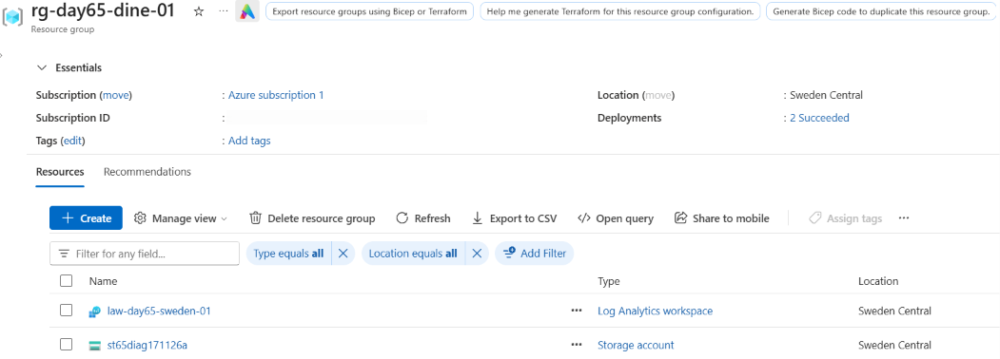
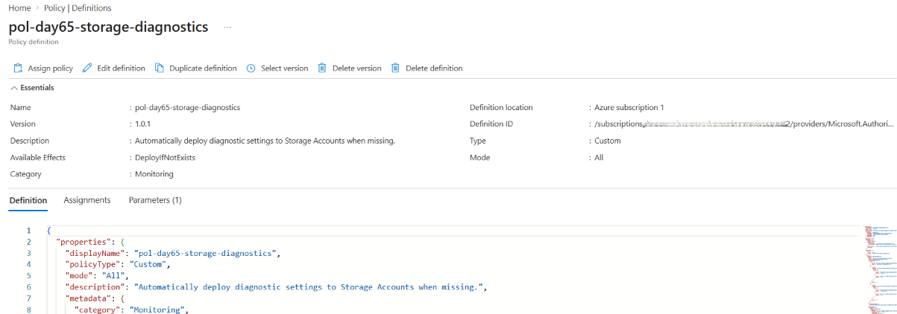
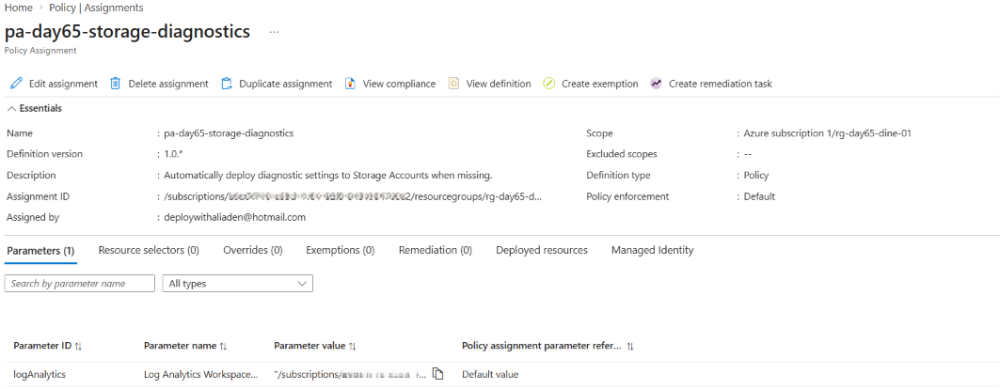
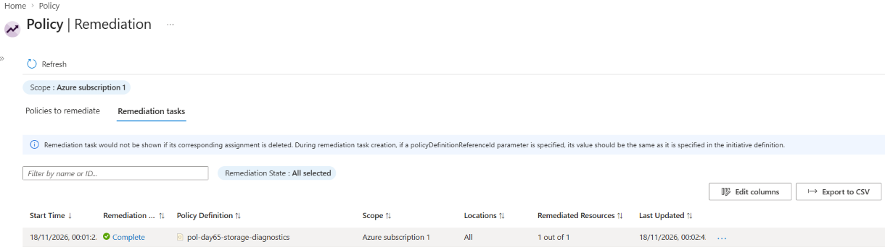
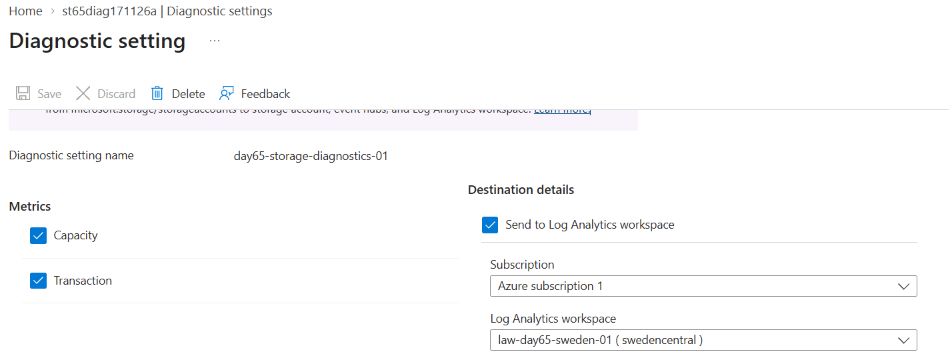
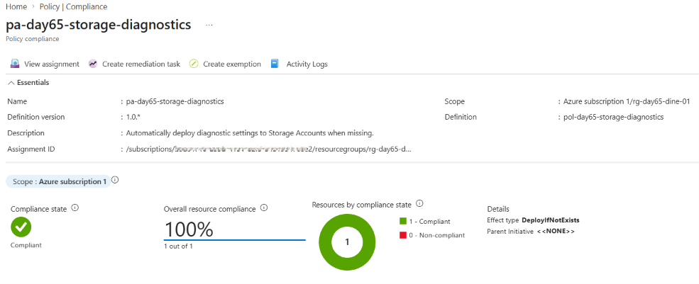

# Day 65 – Create a Policy with DeployIfNotExists Effect

### Azure 100 Days of Cloud Challenge — Ali Aden

## Project Overview

For Day 65, I created a custom Azure Policy using the `DeployIfNotExists` effect.

The aim was to make sure that Azure Storage Accounts have diagnostic settings configured correctly and send their metrics to a Log Analytics Workspace.

I created the policy, assigned it to my resource group and configured a managed identity so Azure Policy could deploy the required diagnostic settings automatically.

During testing, I encountered a remediation error because the `Microsoft.Insights` resource provider had not been registered. I also had to correct the policy's existence condition so it checked the actual metric categories being deployed.

After making these changes, remediation completed successfully and the resource showed as compliant.

## Architecture

The lab uses Azure Policy to check whether the Storage Account has the required diagnostic settings.

If the settings are missing or do not match the policy requirements, Azure Policy can deploy them through a remediation task.

```text
                  Azure Subscription
                          |
                          |
                 Resource Group
                rg-day65-dine-01
                          |
             +------------+------------+
             |                         |
             |                         |
       Storage Account          Log Analytics
       st65diag171126a          Workspace
             |                  law-day65-sweden-01
             |                         ^
             |                         |
             |                  Diagnostic Settings
             |                  Capacity + Transaction
             |                         |
             +-------------------------+
                          ^
                          |
                     Azure Policy
              pol-day65-storage-diagnostics
                          |
                  Policy Assignment
              pa-day65-storage-diagnostics
                          |
                  Remediation Task
                          |
                System-assigned Identity
                          |
                 Monitoring Contributor
```

The policy checks the Storage Account and looks for a diagnostic setting that sends the Capacity and Transaction metrics to the specified Log Analytics Workspace.

If the required configuration is missing, the remediation process deploys it using the managed identity.

## Azure Configuration

| Setting | Configuration |
|---|---|
| Subscription | Azure subscription 1 |
| Region | Sweden Central |
| Resource Group | rg-day65-dine-01 |
| Storage Account | st65diag171126a |
| Log Analytics Workspace | law-day65-sweden-01 |
| Custom Policy | pol-day65-storage-diagnostics |
| Policy Version | 1.0.1 |
| Policy Assignment | pa-day65-storage-diagnostics |
| Diagnostic Setting | day65-storage-diagnostics-01 |
| Policy Effect | DeployIfNotExists |
| Managed Identity | System-assigned |
| Role Assignment | Monitoring Contributor |
| Metrics | Capacity and Transaction |

## Implementation

### 1. Create the Azure Resources

I created a new resource group called `rg-day65-dine-01` in Sweden Central.

Inside the resource group, I deployed:

- A Storage Account named `st65diag171126a`.
- A Log Analytics Workspace named `law-day65-sweden-01`.

The Storage Account was the resource I wanted to monitor, while the Log Analytics Workspace would receive its diagnostic metrics.

### 2. Create the Custom Azure Policy

I created a custom policy definition called `pol-day65-storage-diagnostics`.

The policy uses the `DeployIfNotExists` effect. This means Azure checks whether the required diagnostic settings exist. If they do not, the policy can deploy them through remediation.

The policy checks for:

- The correct Log Analytics Workspace.
- The Capacity metric enabled.
- The Transaction metric enabled.

I initially created the policy with an incorrect existence condition. After checking the diagnostic settings, I updated the policy to match the actual metric categories.

The final policy version is `1.0.1`.

### 3. Assign the Policy and Configure Permissions

I assigned the policy to the resource group `rg-day65-dine-01`.

I enabled a system-assigned managed identity for the policy assignment and gave it the Monitoring Contributor role.

This allows the managed identity to carry out the required deployment during remediation.

### 4. Run the Remediation Task

After assigning the policy, I created a remediation task.

The first remediation attempt failed with the following error:

`InvalidAuthenticationToken: Please register the subscription with Microsoft.Insights.`

I investigated the error and found that the `Microsoft.Insights` resource provider had not been registered in the subscription.

I registered the resource provider and ran the remediation task again.

The second attempt completed successfully, with 1 out of 1 resources remediated.

### 5. Validate the Diagnostic Settings

I opened the Storage Account and checked its diagnostic settings.

I confirmed that:

- The Log Analytics Workspace was `law-day65-sweden-01`.
- Capacity metrics were enabled.
- Transaction metrics were enabled.

This confirmed that the remediation task had deployed the expected diagnostic configuration.

### 6. Check Policy Compliance

After correcting the policy's existence condition and completing remediation, I checked the compliance results.

The final compliance view showed:

- 1 resource compliant.
- 0 resources non-compliant.
- 100% compliance.

This confirmed that the Storage Account matched the requirements in my custom policy.

## Custom Azure Policy Definition

The following is the final corrected policy definition, version `1.0.1`.

```json
{
  "mode": "All",
  "parameters": {
    "logAnalytics": {
      "type": "String",
      "metadata": {
        "displayName": "Log Analytics Workspace Resource ID",
        "description": "Resource ID of the destination workspace."
      },
      "defaultValue": "/subscriptions/b9a64710-a53d-4151-82f3-5451954768e2/resourceGroups/rg-day65-dine-01/providers/Microsoft.OperationalInsights/workspaces/law-day65-sweden-01"
    }
  },
  "policyRule": {
    "if": {
      "field": "type",
      "equals": "Microsoft.Storage/storageAccounts"
    },
    "then": {
      "effect": "DeployIfNotExists",
      "details": {
        "type": "Microsoft.Insights/diagnosticSettings",
        "name": "day65-storage-diagnostics-01",
        "existenceCondition": {
          "allOf": [
            {
              "field": "Microsoft.Insights/diagnosticSettings/workspaceId",
              "equals": "[parameters('logAnalytics')]"
            },
            {
              "count": {
                "field": "Microsoft.Insights/diagnosticSettings/metrics[*]",
                "where": {
                  "allOf": [
                    {
                      "field": "Microsoft.Insights/diagnosticSettings/metrics[*].category",
                      "equals": "Capacity"
                    },
                    {
                      "field": "Microsoft.Insights/diagnosticSettings/metrics[*].enabled",
                      "equals": true
                    }
                  ]
                }
              },
              "greater": 0
            },
            {
              "count": {
                "field": "Microsoft.Insights/diagnosticSettings/metrics[*]",
                "where": {
                  "allOf": [
                    {
                      "field": "Microsoft.Insights/diagnosticSettings/metrics[*].category",
                      "equals": "Transaction"
                    },
                    {
                      "field": "Microsoft.Insights/diagnosticSettings/metrics[*].enabled",
                      "equals": true
                    }
                  ]
                }
              },
              "greater": 0
            }
          ]
        },
        "roleDefinitionIds": [
          "/providers/Microsoft.Authorization/roleDefinitions/749f88d5-cbae-40b8-bcfc-e573ddc772fa"
        ],
        "deployment": {
          "properties": {
            "mode": "incremental",
            "template": {
              "$schema": "https://schema.management.azure.com/schemas/2019-04-01/deploymentTemplate.json#",
              "contentVersion": "1.0.0.0",
              "parameters": {
                "storageAccountName": {
                  "type": "string"
                },
                "workspaceId": {
                  "type": "string"
                }
              },
              "resources": [
                {
                  "type": "Microsoft.Storage/storageAccounts/providers/diagnosticSettings",
                  "apiVersion": "2021-05-01-preview",
                  "name": "[concat(parameters('storageAccountName'), '/Microsoft.Insights/day65-storage-diagnostics-01')]",
                  "properties": {
                    "workspaceId": "[parameters('workspaceId')]",
                    "metrics": [
                      {
                        "category": "Capacity",
                        "enabled": true
                      },
                      {
                        "category": "Transaction",
                        "enabled": true
                      }
                    ]
                  }
                }
              ]
            },
            "parameters": {
              "storageAccountName": {
                "value": "[field('name')]"
              },
              "workspaceId": {
                "value": "[parameters('logAnalytics')]"
              }
            }
          }
        }
      }
    }
  }
}
```

## Validation

I used the Azure Portal to check each stage of the configuration and capture evidence that the policy was working correctly.

### 1. Infrastructure



The resource group contains the Storage Account and Log Analytics Workspace created for this lab.

### 2. Custom Policy



The custom policy definition shows version 1.0.1 and the DeployIfNotExists effect.

### 3. Policy Assignment



The policy assignment shows the resource group scope and assignment configuration.

### 4. Remediation Results



The remediation task completed successfully, with 1 out of 1 resources remediated.

### 5. Diagnostic Settings



The Storage Account diagnostic settings show Capacity and Transaction metrics enabled and connected to the Log Analytics Workspace.

### 6. Policy Compliance



The final compliance result shows 100% compliance, with 1 compliant resource and 0 non-compliant resources.

## Cost Considerations

I used my Azure Free Account for this lab and kept the deployment limited to the resources needed for the challenge.

However, using a free account does not automatically mean every service is free.

A few things to consider:

- Log Analytics data ingestion and retention can incur charges depending on usage and pricing.
- Storage Account operations and transactions may also have costs.
- Diagnostic settings can send data to a destination that has its own pricing.
- I would check the Azure Cost Management page and the relevant service pricing before using this setup in a production environment.

For this lab, I avoided adding unnecessary resources or enabling extra services.

## Lessons Learned

This lab helped me understand how Azure Policy can do more than just identify non-compliant resources.

A few things I learned during the process:

- `DeployIfNotExists` can automatically deploy configuration when a resource does not meet the policy requirements.
- A managed identity needs the correct permissions before remediation can work.
- The `Microsoft.Insights` resource provider must be registered for the diagnostic settings deployment used in this lab.
- The existence condition must match the configuration that the deployment actually creates.
- A successful remediation task does not replace checking the final compliance result.

The main issue I encountered was the mismatch between the original policy condition and the actual diagnostic metric categories. Correcting the condition to check Capacity and Transaction allowed the resource to become compliant.

## Skills Demonstrated

- Azure Policy and custom policy definitions.
- DeployIfNotExists effect.
- Policy assignments and resource group scopes.
- Managed identities and role-based access control (RBAC).
- Azure Resource Provider registration.
- Azure Monitor diagnostic settings.
- Log Analytics Workspace configuration.
- Policy remediation and compliance validation.
- Troubleshooting Azure deployment errors.
- JSON and ARM template configuration.

## Project Outcome

I successfully created and assigned a custom Azure Policy using the DeployIfNotExists effect.

The policy checks Azure Storage Account diagnostic settings and deploys the required configuration to send Capacity and Transaction metrics to a Log Analytics Workspace.

After resolving the resource provider registration issue and correcting the policy's existence condition, the remediation task completed successfully.

The final compliance result showed 100% compliance, with 1 out of 1 resources compliant.

This challenge gave me practical experience with Azure Policy remediation, managed identities, RBAC permissions and monitoring configuration. These are useful skills for managing and securing Azure environments.
